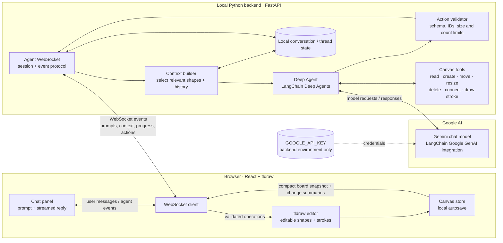
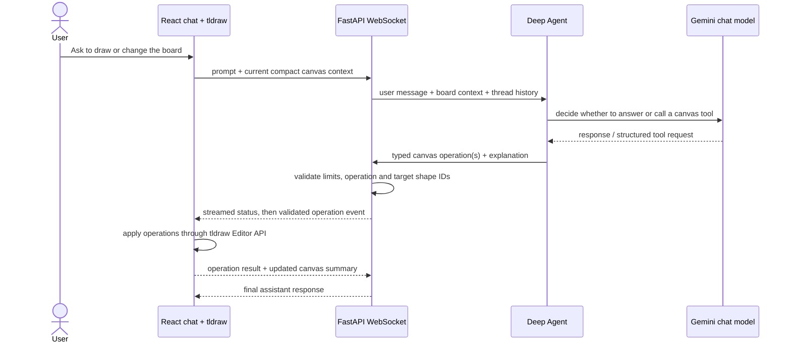

# Canvas agent architecture — proposal

**Implementation status:** the approved chat milestone is implemented. See README.md for startup, protocol limits, tests, and deployment boundaries. Voice and multiplayer remain future milestones.

## Chat-first architecture

## One chat turn

## Decisions for the first agent milestone

- **Chat transport:** one local WebSocket between the browser and FastAPI. It carries chat turns and agent events; it is not itself the model or the agent.
- **Agent:** Python `deepagents` with explicit, narrowly scoped canvas tools. The agent can only change the board through validated operations.
- **Model:** a Gemini chat model accessed server-side through LangChain's Google GenAI integration. `GOOGLE_API_KEY` remains in the backend environment and is never sent to the browser.
- **Canvas authority:** tldraw remains authoritative for the live board. The backend returns operations; the frontend applies them with the tldraw Editor API and reports the resulting state. This keeps agent edits identical to normal editable canvas objects.
- **Context:** send the user prompt, a compact structured board description (stable tldraw IDs, shape types, text, positions), and relevant thread history. Do not stream screenshots or every pointer movement.
- **Safety:** validate operation names, stable IDs, coordinates, text size, and operations per turn. Destructive edits such as deleting or replacing many objects should ask the user before application.
- **Persistence:** tldraw IndexedDB stores boards and media in the browser. SQLite stores conversations, request deduplication, and action audit records per stable board ID. Export/import provides manual board backups. Active agent graph executions are cancelled on disconnect; conversation history survives restart.
- **Not in this milestone:** voice, Gemini Live sessions, multi-user sync, remote MCP, and background observation of the screen.

## Voice extension

Once chat and canvas tools work reliably, voice can add a microphone / speaker transport and a Gemini Live session. The same validated canvas action layer stays in place. For an initial voice version, the backend can bridge audio to Gemini Live and route its tool calls into the existing action validator. The chat Deep Agent remains available for longer, multi-step requests.

## Flow sequence

1. User sends a message from the canvas chat panel.
2. Browser sends the prompt with the current compact board state over WebSocket.
3. Deep Agent reasons with Gemini and calls only the canvas tools needed.
4. Backend validates each proposed operation and streams progress to the chat.
5. Frontend applies accepted operations to tldraw; those shapes and strokes remain manually editable.
6. Frontend returns the resulting state summary so the agent can confirm what changed.

## References

- [LangChain Deep Agents overview](https://docs.langchain.com/oss/python/deepagents/overview)
- [Gemini Live API overview](https://ai.google.dev/gemini-api/docs/live-api)
- [Gemini Live API WebSocket guide](https://ai.google.dev/gemini-api/docs/live-api/get-started-websocket)
- [tldraw sync documentation](https://tldraw.dev/docs/sync)
