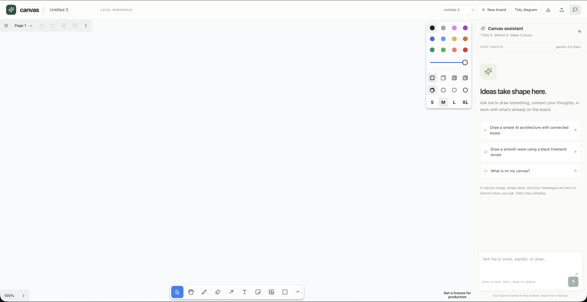
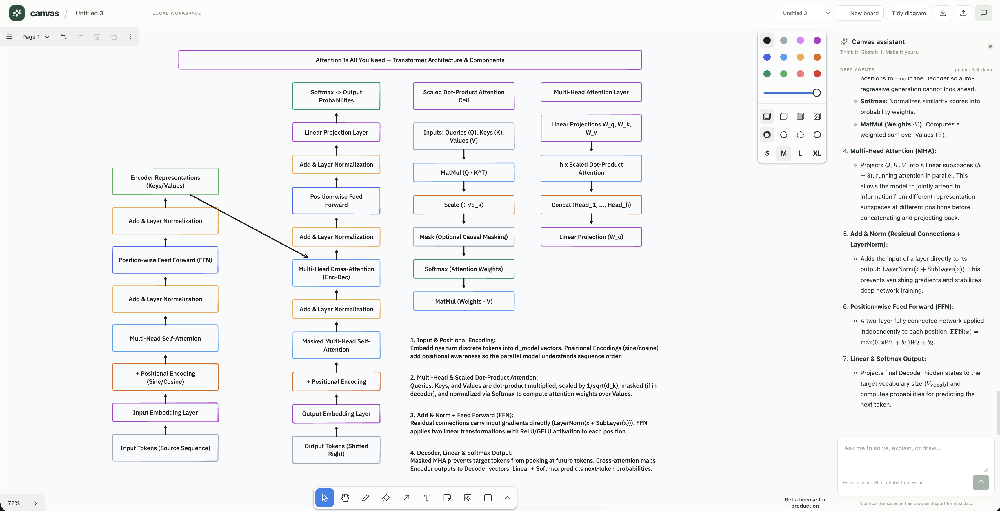

# Canvas + Deep Agents

A local React/tldraw workspace with a chat assistant built using LangChain Deep Agents and Gemini. Gemini returns a validated structured plan; Deep Agents executes canvas tools and waits for browser confirmation. The agent reads structured canvas state and creates **editable** shapes, text, connected arrows, and freehand strokes. You can move, resize, rename, or delete objects through chat and undo an entire agent batch with Cmd/Ctrl+Z.

## Product walkthrough

Canvas combines an infinite drawing surface with a chat assistant. The assistant can inspect the current canvas, understand the visible board, answer questions, and create editable diagrams through confirmed canvas operations.

### Starting a workspace

The initial workspace provides the blank canvas, drawing tools, board controls, and suggested prompts for common actions.



### Building and explaining a diagram

Ask the assistant to create a diagram or expand an existing selection. The result stays editable: nodes, labels, arrows, and explanatory notes are separate canvas objects. Connected diagrams are arranged using the relationships between nodes, and the chat panel streams the explanation alongside the canvas.



The screenshots above are stored in [`Images/`](Images/). They are also useful as a quick visual check after starting the local app: the first shows the workspace before an edit, and the second shows the assistant creating and explaining a detailed Transformer architecture.

### Demo video

<video controls playsinline preload="metadata" width="100%">
  <source src="Images/Video/Intro.mp4" type="video/mp4" />
  Your browser does not support embedded video. [Open the Canvas demo video](Images/Video/Intro.mp4).
</video>

The video is also available as a direct link: [Canvas demo video](Images/Video/Intro.mp4).

## Run

Requires Python 3.12+ and Node 22.12+ (tested with Python 3.12 / Node 24.14).

From the project root, install the backend dependencies:

```sh
python3 -m venv .venv
source .venv/bin/activate
pip install -r backend/requirements.lock.txt
```

The root `.env` is loaded automatically. Keep the existing `GOOGLE_API_KEY` there, or export it in your shell. The shell value takes precedence. `.env.example` documents configuration; do not overwrite your existing `.env`.

```dotenv
GOOGLE_API_KEY=your-key
GEMINI_MODEL=gemini-2.5-flash
```

Build the frontend, then run the single local server:

```sh
cd frontend
npm ci
npm run build
cd ..
.venv/bin/python -m uvicorn backend.main:app --host 127.0.0.1 --port 8000 --ws-max-size 1000000
```

Open **http://127.0.0.1:8000**. The backend serves both the compiled frontend and `/api/ws/{board_id}`. One process handles the local workspace. Keep the server running while using the assistant.

For development, run `uvicorn backend.main:app --reload --host 127.0.0.1 --port 8000 --ws-max-size 1000000` from the project root, and `npm run dev` from `frontend/`. Vite proxies `/api`, including WebSockets. Restart the backend after changing environment variables.

## Try it

- “Draw a smooth black wave.”
- “Draw three boxes named Input, Model, and Output, and connect them.”
- “Move the Model box down by 150 pixels.”
- “Solve the handwritten equation on my canvas and show the steps.”
- “Write the solution underneath the equation.”
- “What is selected on my canvas?”
- “Delete the Output box.” (The UI asks you to approve the deletion.)

The chat panel streams responses and reports connection and tool progress. Stop interrupts the current run; already applied edits remain undoable. New board creates a separate saved board and conversation. The board selector switches between them.

## Data and recovery

- **Canvas documents and uploaded media:** tldraw's IndexedDB storage in the browser, keyed by board ID. Persistence is tied to the browser profile and origin. `localhost:5173` and `127.0.0.1:8000` have separate browser storage; export/import to transfer a board.
- **Board names and selection:** browser localStorage.
- **Conversations, request IDs, action audit:** SQLite in `backend/data/canvas.sqlite3`, using WAL and transactional writes. Back up the data directory while the backend is stopped, or use SQLite's backup API.
- **Export/import:** use the header buttons for JSON backups. Import requires an empty board. Exported media may reference browser-local assets; for portable media, also use tldraw's native file export from its menu. Shape-only JSON backups are portable.
- **Previous prototype:** the old `canvas-document-v1` browser snapshot is migrated into the first board, once, on the same origin. Its source backup is retained. The old global `/canvas` JSON endpoint has been replaced with browser persistence and explicit export.
- **Interrupted runs:** disconnect cancels the agent. Reconnect restores persisted chat; it never silently replays mutations. If an acknowledgement was lost, inspect the board before retrying.
- **Model context:** the latest 24 conversation messages plus the current page's shapes, text, geometry, selection, and viewport. A bounded image of the current canvas page is attached on each chat turn so Gemini can read handwriting and diagrams. It captures only canvas content, not the browser or desktop. Images are not stored in conversation history. Updates reach the local backend while connected; model calls happen on chat turns.

## Reliability boundaries

Drawing requests are Pydantic-validated on the backend and Zod-validated in the browser. Every edit carries a page ID and revision. A human edit during model planning makes the pending batch stale; the agent must reread the canvas. The browser applies batches as one undoable transaction and rolls them back if any operation fails. The agent waits for an actual acknowledgement before reporting tool success. All deletions require explicit UI approval.

Limits: 400 shapes per page for agent context, 40 operations per batch, 120 operations per turn, 500 points per stroke, 8,000 characters per user message, 120 seconds for action approval/acknowledgement, and 240 seconds per agent turn. Grouped, rotated, and locked objects are left for manual editing. The server accepts one active editor connection per board and one agent run per connection.

Deep Agents provides the tool-calling loop and planning. Its filesystem/execute/delegation tools are excluded for this canvas agent. No host filesystem or shell tools are exposed. Keys remain server-side; provider exception text and prompt content are not logged. Agent outcomes and operation payloads are stored locally for auditing.

## Deployment scope

This is hardened for the approved **single-user local architecture**. It binds to loopback, checks Host and WebSocket Origin, bounds messages/runs, and serves a production frontend build with locally bundled tldraw fonts/icons. It is not an authenticated multi-tenant service. Before exposing it to the internet, add identity and board authorization, TLS, shared session coordination, per-user rate/budget limits, and shared durable storage. Run only **one backend worker** in this version.

For commercial/hosted use, configure a tldraw license with `VITE_TLDRAW_LICENSE_KEY` in `frontend/.env.local` before building; see [tldraw licensing](https://tldraw.dev/pricing). Voice and multi-user tldraw Sync remain separate milestones. The attached Gemini Deep Research document is reference material; this implementation uses Gemini chat function calling through Deep Agents, not the hosted research product.

## Verify

```sh
.venv/bin/python -m pip install -r backend/requirements-dev.txt
.venv/bin/python -m pytest backend/tests -q
cd frontend
npm test
npm run build
```

Tests cover real tldraw strokes/connectors/undo/rollback/stale edits, WebSocket acknowledgements and cancellation, conversation persistence and board isolation, duplicate requests, origin checks, schema limits, and provider error redaction.

An optional real-provider smoke check uses a synthetic empty board and incurs Gemini API usage:

```sh
.venv/bin/python -m scripts.smoke_agent
```

It exercises Gemini → Deep Agents → canvas tool → simulated browser acknowledgement. The automated suite uses no API key and makes no provider requests.

For a larger diagram smoke check:

```sh
.venv/bin/python -m scripts.smoke_agent --diagram --prompt 'Draw a complete Transformer architecture with connected boxes and explain attention.'
```

Complete drawing plans support up to 120 operations per turn. The entire plan is validated before dispatch, then sent in browser batches of at most 40 operations, with an acknowledgement and fresh target validation between batches. Rejection or an unknown outcome stops the remaining batches. An empty response before any edit gets one recovery attempt using non-streamed tool calls; dispatched edits are never automatically replayed. Logs record the provider stop reason and token counts without prompt text or credentials. Gemini quota limits can interrupt multi-call diagrams; the chat reports this separately from malformed commands. The Vite large-chunk warning is a build-size advisory and does not cause Gemini tool failures.

On the first malformed tool call, the server switches directly to native JSON structured output using the same 120-operation plan limit (minus operations already dispatched). Invalid plans get one correction with specific validation feedback before any dispatch. Field locations and error types are logged without rejected values. After partial edits, recovery continues from the latest board plus a ledger of acknowledged operations, without replaying the original tool loop. Any rejected or unconfirmed batch blocks automatic continuation. Local validation, stale-board checks, deletion approval, audit, browser acknowledgement, and the total operation budget still apply. Test these paths with `--diagram --structured-recovery` or `--diagram --partial-recovery` on the smoke script; `--history-board BOARD_ID` includes saved conversation context read-only.

## Diagram layout

Connected components use Dagre top-to-bottom layout based on bound arrows, including across separate agent batches. Labels use measured bounds and readable sans-serif type; explanatory notes remain below their associated component. Unrelated board content is kept in place. Elbow connectors attach at node borders; candidate routes are checked against other shapes. A batch that cannot be routed without crossing a node is rolled back and reported to the agent. This checks node intersections, not all possible edge-to-edge crossings, and does not infer missing semantic connections.

Use **Tidy diagram** to repair existing diagrams (selected components, or the whole page); the repair is undoable. Locked, grouped, or rotated nodes are excluded. The isolated `/qa/layout.html` development fixture exercises overlapping initial positions, residual connections, a separate explanation request, and a subsequent layer insertion. It is not bundled into the production application.

## Code map

- `backend/agent.py`: Gemini adapter, Deep Agents harness, read/edit tools.
- `backend/schemas.py`: protocol context and bounded operation schemas.
- `backend/main.py`: WebSocket sessions, cancellation, health, static serving.
- `backend/storage.py`: SQLite conversations, request deduplication, action audit.
- `frontend/src/canvas.ts`: context extraction and atomic tldraw operation executor.
- `frontend/src/useAgent.ts`: connection lifecycle, streaming, approvals, acknowledgements.
- `frontend/src/App.tsx`: board management, backups, and chat UI.

The implementation follows the [Deep Agents customization guide](https://docs.langchain.com/oss/python/deepagents/customization), [Google GenAI integration](https://docs.langchain.com/oss/python/integrations/chat/google_generative_ai), and [Deep Agents examples](https://github.com/langchain-ai/deepagents/tree/main/examples).
